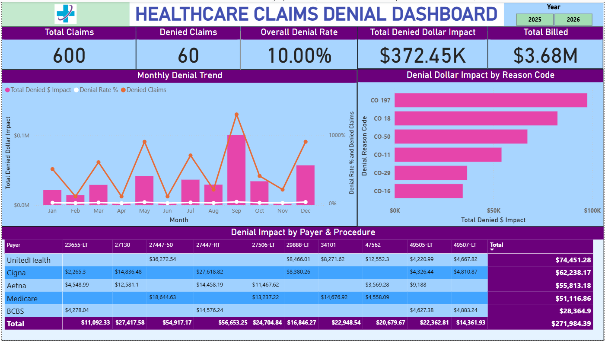

# Claims Denial Root-Cause Dashboard

A Power BI dashboard that identifies *why* healthcare claims get denied — broken down by reason code, payer, and procedure — so a billing team can prioritize which issues to fix first.

**Note on the data:** all claims and patients in this project are synthetic; no real patient data was used. The ICD-10-CM and CPT codes are standard published codes, combined into valid diagnosis–procedure pairs from a curated reference set (`data/reference-data.json`). These generic pairs are not linked to any patient or case and were used to generate 600 synthetic claim records in Python.

---

## Situation

Claim denials are one of the largest sources of lost or delayed revenue for healthcare organizations. Knowing the overall denial rate isn't enough — billing teams need to know *which* denial reasons cost the most money, and *where* (which payer, which procedure) to focus corrective action first.

## Task

Build a Power BI dashboard that surfaces denial root causes clearly enough for a billing team to act on: total dollar impact, trends over time, and a breakdown by denial reason, payer, and procedure — with the ability to drill into the actual claims behind any number.

## Action

- **Generated a synthetic dataset** of 600 claims in Python, targeting a realistic ~10% denial rate, seeded with real ICD-10/CPT code pairings from my own coding background
- **Validated the data by hand** before trusting it, and caught two denial-logic issues where a reason code was being applied to claims that shouldn't have qualified for it — both were corrected so each denial reason only applies to genuinely matching scenarios
- **Caught a data-realism issue during dashboard review**: an early version of the dashboard showed one modifier-related denial reason accounting for 58% of all denied dollars — a number that wouldn't hold up in a real organization, since a recurring coding error at that scale would normally get caught and corrected quickly. I traced the cause back to the underlying reference data, confirmed the error scenario no longer applied, and removed the now-unnecessary code that had been generating it. This dropped total denied dollar impact from $589K to a more realistic $372K, spread across six genuine denial reasons instead of one dominant artifact.
- **Built the SQL Server backend**: a `Claims` table and five analysis queries covering denial rate, monthly trend, dollar impact by reason, denial rate by payer/procedure, and top denial reasons
- **Built the Power BI dashboard**, connected directly to SQL Server with DAX measures: KPI cards, a monthly denial trend chart, a bar chart ranking denial reasons by dollar impact, a payer × procedure matrix, a year slicer, and a drill-through page showing the individual claims behind any reason code

## Result

The final dashboard shows **CO-197 (missing prior authorization)** as the top denial reason by dollar impact, followed by CO-18 (duplicate claim), CO-50 (not medically necessary), CO-11 (diagnosis inconsistent with procedure), CO-29 (timely filing), and CO-16 (coding error) — a realistic, actionable spread rather than one dominant issue.

- **Total Claims:** 600
- **Denied Claims:** 60 (10.00% denial rate)
- **Total Denied Dollar Impact:** $372.45K
- **Total Billed:** $3.68M

The dashboard is fully interactive: click any bar or matrix cell to drill through to the underlying claims, and use the year slicer to filter the trend view.

---

## Tools used
Python (synthetic data generation), SQL Server (data modeling and analysis queries), Power BI (DAX measures, dashboard design)
